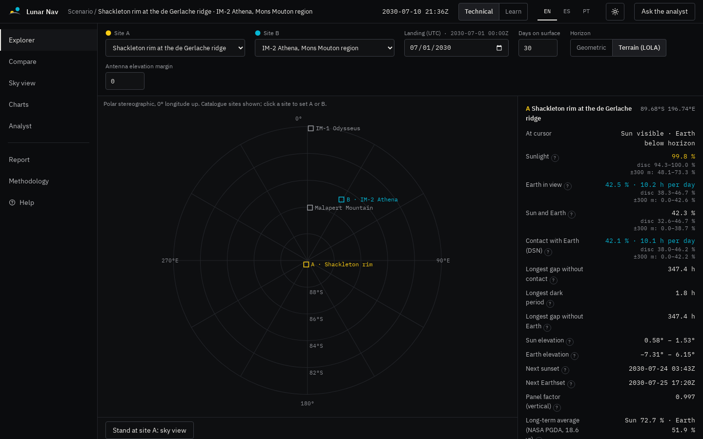
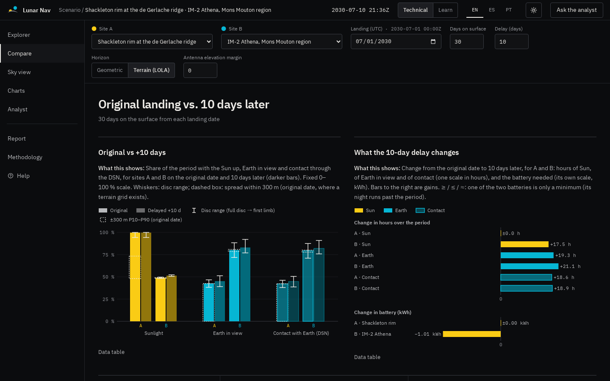
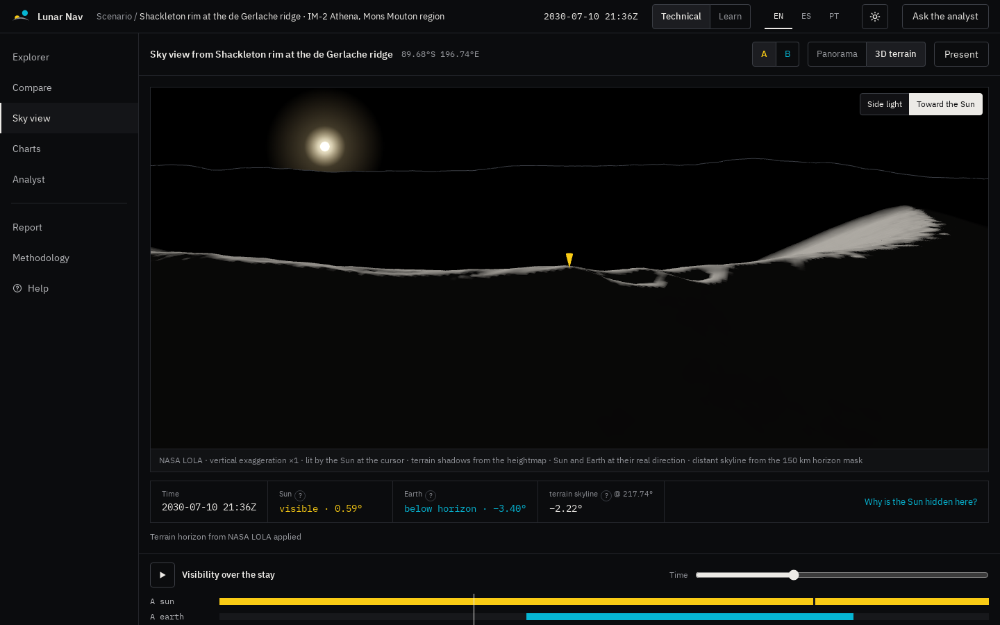

# Lunar Nav

**Live app:** https://lunarnav.space · **Demo video:** VIDEO_LINK · **Kids edition (bonus):** https://kids.lunarnav.space







**Landing-site navigator for the lunar south pole.** Lunar Nav compares landing sites and dates by where the Sun and Earth sit against the local horizon, for how long, and what a schedule change does to both. Built for the NASA Space Apps Challenge 2026, challenge *Lunar Landing Site Navigator*.

Team **Lumi Lunar** · Luana Santos — individual project · Licence: Apache-2.0 · Languages: English, Español, Português (the first visit opens in English; the choice is remembered; `?lang=es` or `?lang=pt` in a link opens that language and saves it)

Created by Luana Santos. The idea, research, product decisions, design and validation are the author's own. AI tools, which NASA Space Apps calls Super Intelligence (SI), were used under her direction to speed up implementation (Claude by Anthropic); every change was reviewed and approved by her. See [AI_DISCLOSURE.md](AI_DISCLOSURE.md).

> Lunar Nav is an independent project. It is not affiliated with or endorsed by NASA. It uses NASA and JPL public data and services, cited in [REFERENCES.md](REFERENCES.md).

## Why Lunar Nav

**The problem.** At the lunar south pole the Sun skims the horizon, so a few hundred metres or a few days can decide whether a lander has sunlight, can see Earth, or sits in the dark. The tools that answer this in detail are built for specialists and take time to learn. Space agencies are heading there: NASA plans a Moon Base in the south polar region, and the Canadian Space Agency's first lunar rover "was set to land on the south pole of the Moon" to help find water ice (the project has since ended; see [REFERENCES.md](REFERENCES.md)).

**Who it's for** (fictional examples):
- *Ana, mission planner:* the landing slipped 10 days and she needs a clear answer by tomorrow.
- *Carlos, science teacher:* he wants to show his class why the lunar south pole is so hard.
- *Júlia, university student:* she needs numbers she can trust and cite.

**What it reveals** (30 days from 1 July 2030, terrain horizon, unless noted):
- Shackleton rim ridge: 99.8 % sunlight at the published point, but 48–73 % (P10–P90) within 300 m.
- Malapert: 0 % sunlight from January to June 2030, and again in December.
- IM-2: landing on 1 July 2030 means arriving in darkness; landing 10 days later gives 250.8 h of daylight before the first night.

**How it compares.** LROC QuickMap, NASA Moon Trek and JPL Horizons are built for detailed analysis. Lunar Nav is for the quick decision: it builds on them (Horizons ephemerides, NASA LOLA terrain) and is checked against NASA PGDA's long-term illumination maps (Methodology → Validation).

Built on two NASA APIs (JPL Horizons, Scientific Visualization Studio) and four NASA datasets (LOLA, PGDA, DSN 810-005, LROC).

---

## What it does

| Screen | What you get |
|---|---|
| **Briefing** (`#/`) | The problem in one sentence, live numbers for the default pair of sites, a 60-second tour. |
| **Explorer** (`#/planner`) | Polar map of catalogue sites, per-site readout (sunlight %, Earth in view %, both, longest dark period, longest gap without Earth, next sunset / Earthset, panel factor), visibility timeline, elevation chart. Geometric or terrain (LOLA) horizon, antenna elevation margin. |
| **Compare** (`#/compare`) | Original landing vs. delayed landing for both sites; delay deltas; search for landing dates that meet constraints; sensitivity map (how the result changes a few hundred metres away). |
| **Sky view** (`#/sky`) | 360° horizon panorama with Sun and Earth tracks and terrain skyline; 3D terrain lit from the Sun at the cursor; present mode; playback. |
| **Charts** (`#/charts`) | Six read-only charts of the same data, each with a one-line reading, a legend, a screen-reader summary and a data table: sites side by side (with disc range and ±300 m P10–P90), 2030 month by month, our model vs NASA PGDA, battery needed by site, what a delay changes, and the ±300 m sunlight histogram at site A. Findings: Malapert gets 0 % sunlight from January to June 2030 (and again in December); within 300 m its battery need ranges from 1.7 kWh to at least 108 kWh; at IM-2 the date decides — landing on 1 July 2030 means arriving in darkness (0 h of daylight before the first night), landing 10 days later gives 250.8 h. |
| **Analyst** (`#/analyst`) | Ask in plain language (typed, or spoken with ElevenLabs speech-to-text). Claude (Anthropic) answers **only** from Lunar Nav tool results, with citations; every tool call is shown. The answer's summary can be read aloud (ElevenLabs AI voice, labelled; the browser's own voice if unavailable). Repeated questions are answered from a cache, marked "cached answer". |
| **Report** (`#/report`) | Printable/PDF scenario report; JSON, CSV and Markdown downloads with full provenance. |
| **Methodology** (`#/methodology`) | Premises, validation status, provenance of the current result, use of AI, sources. |

Every number carries provenance: data source, method version, site source, Horizons parameters, step, horizon mode (geometric / terrain / *terrain unavailable for this site*), margins, cache state.

The horizon defaults to **Terrain (LOLA)** wherever a NASA LOLA mask exists; sites without one (Chandrayaan-3) use the smooth sphere and say *terrain unavailable for this site*. The user's choice (top bar, or `mode=` in the URL) always wins.

## Trust: privacy, testing and data integrity

**Privacy (LGPD, Brazil's data protection law)**
- No accounts, no tracking cookies and no analytics.
- Client addresses are stored only as salted hashes (HMAC-SHA256) for the hourly limits. The salt is kept outside the web root, and the records are deleted after 48 hours.
- Analyst questions that look like personal data (e-mail, phone, CPF) are not cached. Cached answers are kept for 90 days, under a hash of the question, with no address.
- The *Privacy & Terms* page (`#/privacy`) explains what is processed and why, the international transfer to Anthropic and ElevenLabs (USA), and the user's rights under the LGPD (art. 18).
- The Kids edition collects nothing: no Analyst, no microphone, no forms and no cookies; it stores only the language choice in the browser (in line with LGPD art. 14 on children's data).
- Secrets are kept out of the repository and out of both deploy packages. This is checked by searching for key patterns and for the real key values.

**Testing and accessibility** (run on 15 November 2026)
- Main app: PHP 236/236 checks, Python 8/8 (pytest), JavaScript 131/131 (vitest). Kids edition: 22/22 (vitest).
- axe-core (WCAG 2.1 A/AA and best practices), with 0 violations:
  - main app: 198 page views (11 screens × 3 languages × 3 sizes × 2 themes);
  - Kids: 54 page views (6 screens × 3 languages × 3 sizes).
- No horizontal scrolling on phones, tablets or desktops.
- Both deploy packages were tested on Apache with HTTPS and their Content Security Policy: 0 CSP violations, 0 console errors and 0 failed requests. That covers 30 page views of the main app, including the 3D view and its worker, and 54 of the Kids edition, with no requests outside the site.
- Keyboard navigation with visible focus, labels and live regions for screen readers, light and dark themes, and layouts for phones and tablets.

**Data integrity**
- Every number comes from deterministic code and NASA/JPL data, never from SI.
- Each result carries its provenance: source, Horizons parameters, horizon model, margins and method version.
- Validation against NASA PGDA: the ranking of the five sites by sunlight is identical, and the differences are documented in Methodology. The current `validation.json` has 19 checks:
  - 17 pass (8 integration tested, 9 numerically verified);
  - 1 is informative (DEM resolution);
  - 1 is "needs investigation": the PGDA comparison, where Malapert is 10.7 points off at the exact point while the 300 m medians agree within 4.8 points.
- Data audit (last recorded run, 15 November 2026):
  - texts versus the API: about 600 numbers in the documents and screens;
  - coherence across screens: 320 computed and 96 in-browser checks, 0 disagreements;
  - the 19 cached Analyst answers re-run tool call by tool call: 0 differences, and all 374 numbers they quote traced to tool results.
- Known limits: no landing-safety assessment (slope, rocks, thermal); the power model is illustrative; uncertainty is shown as the disc range and the ±300 m range.

## Architecture

```
frontend/   React 18 + Vite + Tailwind + three.js (static build → frontend/dist)
api/        PHP 8.2, no framework. JSON API under /api
  src/Horizons   JPL Horizons client + CSV parser (cached forever)
  src/Metrics    interval metrics, scenarios, delay, date search, sensitivity
  src/Terrain    horizon masks, terrain grid, heightmap assets
  src/Geo        ENU frames, direction transfer between nearby points
  src/Agent      tool-use analyst (Claude: answer cache, prompt caching, limits)
  src/Voice      ElevenLabs text-to-speech (cached MP3) and speech-to-text
  src/Usage      daily usage counters and global limits (private)
  bin/           validate.php, warm-cache.php, warm-analyst.php, usage.php, MySQL cache table
  tests/         run.php (offline checks, no paid API calls)
preprocess/ Python: LOLA DEM → horizon masks, grid masks, heightmap, hillshade
kids/       Lunar Nav Kids: a separate static site (Vite + React), its data export and tests
deploy/     deploy packages and guides (main site and deploy/kids/)
docs/       README screenshots
```

Data flow: browser → `/api/metrics` → Horizons series for Sun (10) and Earth (399) from a lunar-surface observer (`CENTER='coord@301'`, geodetic site, `QUANTITIES=4`, `APPARENT=AIRLESS`) → metrics per interval with linear interpolation of horizon crossings → JSON with provenance.

### API

| Method & path | Parameters |
|---|---|
| `GET /api/health` | — (which AI/voice providers are configured) |
| `GET /api/sites` | — |
| `GET /api/terrain?site=` | terrain availability, mask, grid, heightmap meta |
| `GET /api/metrics` | `site` or `lat`,`lon`; `start` (ISO date or Unix s); `days` (1–60); `step` (min); `mode=geometric\|terrain`; `sun_margin`, `earth_margin` (°); `series=1` |
| `GET /api/ephemeris` | same as metrics, always with series |
| `POST /api/compare` | `{scenarios:[{site,start,days,label}], step, mode, …}` (1–4) |
| `GET /api/delay` | metrics params + `delay_days` (−60…60) |
| `GET /api/windows` | `site`, `from`, `to`, `duration_days`, `step_hours`, constraints `min_sun_fraction`, `min_earth_fraction`, `min_earth_hours_per_day`, `min_both_fraction`, `max_dark_hours` |
| `GET /api/sensitivity` | `site`, `start`, `days` (needs a terrain grid) |
| `GET /api/validation` | last `bin/validate.php` result |
| `POST /api/analyst` | `{question, lang, provider, level}` |
| `POST /api/tts`, `POST /api/stt` | voice |

## Run locally

Requirements: PHP 8.2+ with curl, json and mbstring; Node 18+ (Vite 5); (optional) Python 3.10+ for terrain. The server listens on port 8080 in every example below, and the Vite dev server proxies `/api` to it.

```bash
# 1. front end
cd frontend
npm install
npm run build          # → frontend/dist
npm test               # vitest unit tests

# 2. API config
cd ../api
cp config.example.php config.php     # never commit config.php
php tests/run.php                    # offline checks (fake Claude/ElevenLabs, no paid calls)

# 3. serve both (from the project root)
cd ..
php -S localhost:8080 -t frontend/dist api/dev-router.php
# open http://localhost:8080
```

No PHP on your machine? Use Docker:

```bash
docker run --rm -it -p 8080:8080 -v "$PWD":/app -w /app php:8.3-cli \
  php -S 0.0.0.0:8080 -t frontend/dist api/dev-router.php
```

For front-end development with hot reload: run the PHP server on 8080 and `npm run dev` in `frontend/` (Vite proxies `/api` to 8080).

**Offline mode (testing only).** `LUNARNAV_FAKE_HORIZONS=1` replaces JPL Horizons with an analytic test double. Every screen then shows an orange *OFFLINE TEST DATA* banner and the provenance says `FAKE (offline test double)`. Never use it for results.

### Secrets

Put keys in `api/config.php` or environment variables (environment wins):

| Variable | Used for |
|---|---|
| `ANTHROPIC_API_KEY` | Claude analyst |
| `ANTHROPIC_MODEL` | optional: another Claude model (default `claude-opus-5-5`) |
| `ELEVENLABS_API_KEY`, `ELEVENLABS_VOICE_ID` | read answers aloud (text-to-speech) and speech input (speech-to-text) |
| `IP_SALT` | secret for hashing client addresses for the hourly limits (if unset, one is created in a file outside the web root) |

For Docker, keep them in a file outside the project and pass it with `--env-file` (never commit it):

```bash
docker run --rm --env-file /path/outside/the/project/secrets.env -p 8080:8080 -v "$PWD":/app -w /app php:8.3-cli \
  php -S 0.0.0.0:8080 -t frontend/dist api/dev-router.php
```

Without keys the app still works; the Analyst says it is not available, and read-aloud uses the browser's built-in speech. Keys are only used server-side and are never sent to the browser.

## Validate against real Horizons (do this before submitting)

```bash
cd api
php bin/validate.php 2030-07-01 30     # writes data/validation.json, shown on Methodology
php bin/warm-cache.php 2030-07-01 30   # pre-fetches the default scenarios
```

`validate.php` runs: an Apollo 11 control (equatorial site: Sun about half the time, Earth always up); step convergence 60/10/1 minutes; terrain presence per site; a DEM resolution sensitivity check (Shackleton ridge with the 60 m mask). Reference numbers from earlier manual runs (July 2030, geometric): Apollo 11 Sun 49.2 %, Earth 100 % at 59.6–71.7° elevation.

## Terrain (NASA LOLA)

1. Download a LOLA polar stereographic DEM (GeoTIFF) that **covers each site** — see REFERENCES.md (PGDA product 81 for 87.5°S and poleward; IM-2 at 84.8°S and Malapert at 86°S need a product reaching further north, e.g. a polar LDEM product from the LOLA PDS archive covering 80°S–90°S; PDS `.IMG` files with their `.LBL` label open in GDAL/rasterio).
2. Build site assets:

```bash
cd preprocess
pip install -r requirements.txt
pytest -q                                  # unit tests on synthetic DEMs
python build_site_assets.py \
  --dem /path/to/your_lola_dem.tif \
  --sites ../api/data/sites.json \
  --out ../api/data/terrain \
  --product "<exact LOLA product name and version>" \
  --max-dist-km 150 --grid-n 5 --grid-spacing 100   # the settings used for the bundled sites
```

DEM resolution check: `api/data/terrain-dem60/shackleton_ridge/mask.json` is the Shackleton ridge mask rebuilt from LDEM_75S_60M with the same options (`--ids shackleton_ridge --max-dist-km 150 --az-step 0.5 --observer-height 2 --skip-grid`). It is used only by `validate.php` (check *DEM resolution sensitivity*: 91.4 % vs 99.8 % sunlight with the 40 m DEM, default scenario), never by the app.

Check `--units`/`--scale` against the product label (some DEMs store half-metres or kilometres). Sites outside the DEM are skipped and shown in the app as *terrain unavailable for this site*. The output records, per ray, how much of the ray the DEM covered, so a truncated horizon is never presented as complete.

## Deploy (shared hosting, Apache / LiteSpeed + PHP)

Step-by-step guide (Portuguese, Hostinger hPanel): [deploy/DEPLOY.md](deploy/DEPLOY.md).

```bash
(cd frontend && npm run build)
python3 -I deploy/build-zip.py   # → deploy/lunarnav-deploy.zip (not committed)
```

The zip is the content of `public_html`: the built site at the root with `.htaccess` (HTTPS, SPA fallback, blocks, CSP and security headers, long cache for hashed assets), and `api/` with only what production needs (PHP code, horizon masks, reference data, `validation.json`, and the Horizons, Analyst and TTS caches). It never contains `config.php`, keys, tests, DEMs, Python, or the cache records with client data or usage counters. On the server, copy `api/config.example.php` to `api/config.php` and fill in the five fields at the top; `api/data/cache` must be writable. `api/data`, `api/bin` and `api/src` refuse every web request.

Keep the site online until judging ends (January 2027). Use a neutral domain (no "nasa").

## Cost controls

The two paid services are Claude (Analyst) and ElevenLabs (voice). Both are limited so a public demo cannot run up a bill.

**Claude**
- *Answer cache.* An answer is stored for 90 days under a hash of the question (lower case, single spaces), language, mode (Technical/Learn), scenario on screen, earlier turns, method version and model. The same question is answered again without calling Claude and is marked "cached answer". No IP address or other personal data is part of the key.
- *Prompt caching.* The tool definitions and system prompt are identical on every request and are marked cacheable (`cache_control`), so repeated requests read them at a fraction of the input price; the tool loop also reuses its own prefix. If the API rejects the field, requests continue without it.
- *Limits* (in `api/config.php`, `ai.*`): answer length `max_tokens` 1200; at most 6 tool rounds per question; questions up to 500 characters; 15 questions per hour per client; 200 real Claude requests per day for all users (cached answers do not count). When a limit is reached the app shows a polite message in the user's language.
- *Model* (`ai.model`, or `ANTHROPIC_MODEL`). The default is `claude-opus-5-5`. Smaller models cost less per token (for example `claude-sonnet-5-5` or `claude-haiku-5-5`); check that answers still follow the citation and number rules before switching.

**ElevenLabs**
- *Audio cache.* Each spoken text is stored once as an MP3 (`api/data/cache/tts/`, named by a hash of text, voice, model and language) and served with a long browser cache; the same text is never synthesised twice.
- *Summary first.* "Listen to the summary" reads only the Conclusion and Trade-off (no tables, citations or assumptions), at most 900 characters; "Read full answer" reads up to 2 500.
- *Limits* (`voice.*`): read-aloud 20 per hour per client and 60 000 characters per day for all users (cached audio does not count) — beyond that the browser's own voice is used, with a short note; speech input up to 30 s and 2 MB per recording, 10 per hour per client, 60 per day. The transcript goes to the question box and is sent only when you press Run.

**Usage and warm-up**
- `php api/bin/usage.php [days]` prints daily counters (Claude requests and questions, input/output tokens, prompt-cache reads and writes, cached answers, TTS characters and cache hits, STT requests and seconds, limits hit). They are stored in the app cache and are not exposed by the API; `/api/health` only reports which services are configured.
- `php api/bin/warm-analyst.php` pre-generates the answers to the three suggested questions in three languages and both modes for the default scenario, plus the MP3 of each summary. It prints the plan (how many real calls) and does nothing until run with `--yes`.

## Privacy & legal

- **Responsible:** Luana Santos (individual project, team Lumi Lunar). Contact through the GitHub repository (issues); no personal e-mail is published.
- **IP addresses:** never stored in plain text. Only an HMAC-SHA256 hash with a secret salt (`IP_SALT`, or a file created outside the web root) is used for the hourly limits, and those records are deleted after 48 hours. Daily usage counters contain no address. `php api/bin/privacy-cleanup.php --scan` removes expired or old-format records and checks that no address appears in the cache (run it hourly from cron if you like).
- **Questions:** sent to Anthropic (USA) to generate the answer. Identical questions may be answered from a cache for 90 days; the cache holds only the answer and its tool calls under a hash of the question. Questions that look like personal data (e-mail, phone, CPF) are not cached. The Analyst shows a notice not to include personal data.
- **Voice:** microphone recordings are sent to ElevenLabs (USA) for transcription and are not stored (PHP's temporary upload is deleted right after); the first use shows a notice. Audio of answers read aloud is cached; it contains no user data.
- **International transfer:** Anthropic and ElevenLabs are in the USA; each processes data under its own terms. Nothing else is shared or sold.
- **No tracking cookies or analytics.** Only preferences (language, theme, mode, power inputs, microphone notice seen) are kept in the browser's local storage.
- **Rights (LGPD, art. 18):** confirmation, access, correction, anonymisation or deletion, information about sharing, withdrawal of consent — requested through GitHub. The hosting provider's web server logs may hold addresses under its own policy.
- **Terms:** educational and demonstration use; no warranty; not for operational mission decisions; not endorsed by NASA. Code under the Apache License 2.0. The in-app page is *Privacy & Terms* (`#/privacy`, linked in the footer).

## Status of claims

We use a fixed scale: *planned → integration tested → numerically verified → validated for scope*. Current status is shown on the Methodology screen from `data/validation.json`. Earth in view is a geometric line of sight, not a radio link budget. Landing safety (slope, rocks, thermal) is out of scope.

## Use of Super Intelligence (SI)

NASA Space Apps calls AI tools Super Intelligence (SI). Lunar Nav is the author's original project; SI was used under her direction, and every change was reviewed and approved by her.

- **Building the project:** source code, tests and documentation were written and reviewed with Claude (Anthropic).
- **Inside the app:** the Analyst uses Claude, and may only state numbers that come from Lunar Nav's own calculation tools, with a citation for each. Read-aloud and speech input use ElevenLabs. Both are labelled in the app ("AI text", "AI voice").
- **Not produced by SI:** the numbers, which come from deterministic code and NASA/JPL data. No SI-generated images or video are used. The Kids edition has no SI inside it.

Full record: [AI_DISCLOSURE.md](AI_DISCLOSURE.md).

## Licence

Apache License 2.0 — see [LICENSE](LICENSE) and [NOTICE](NOTICE). Third-party components: [THIRD_PARTY.md](THIRD_PARTY.md).

## Bonus: Lunar Nav Kids

**https://kids.lunarnav.space**: the same NASA data, turned into three animated missions for children aged 8–12:
- **The missions:** find the sunniest spot, call home through NASA's Deep Space Network, and charge a battery for the long lunar night.
- **The numbers:** exported from the main API's results and checked against them.
- **Nothing collected:** no SI, no chat and no data collection.
- **Original mascot:** Lumi, drawn in SVG for this project.
- **Languages:** English, Spanish and Portuguese.

Code in [kids/](kids/); deploy guide in [deploy/kids/](deploy/kids/).
